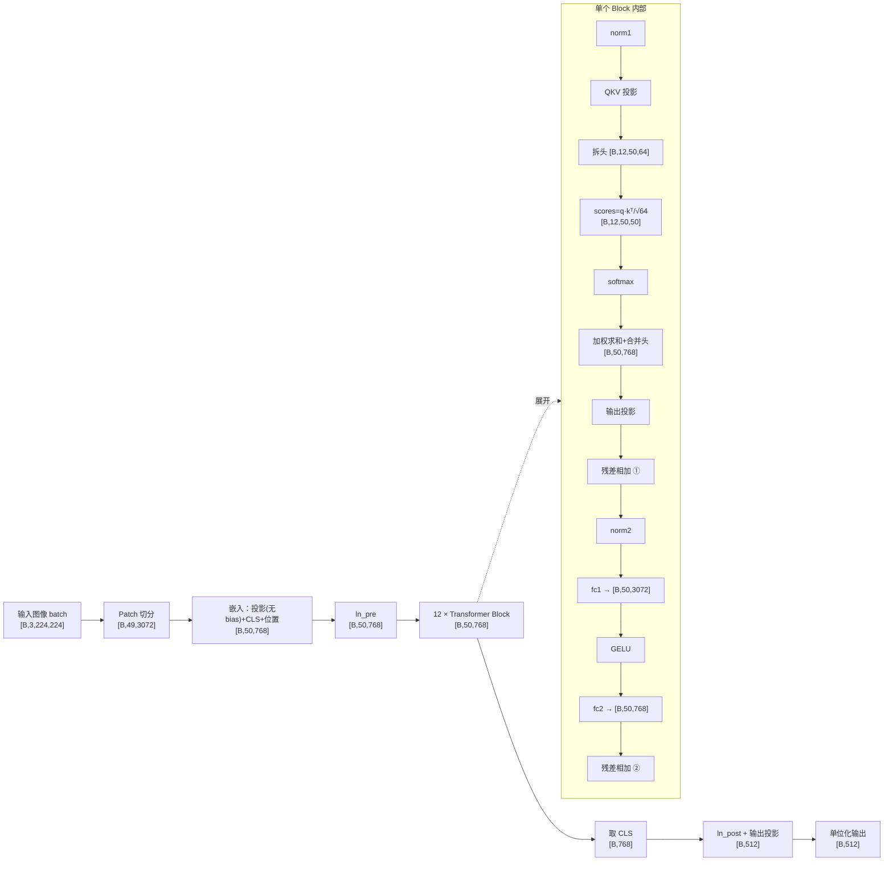
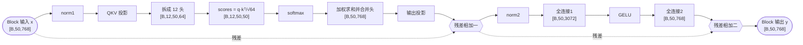
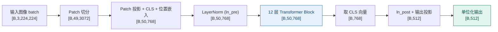

# ViT-B-32 图像编码器架构图 — ProcessOn 输入文档

> 用法三选一：  
> ① 把下面「给 ProcessOn AI 的指令」整段粘贴到 ProcessOn AI 对话框，让它直接生成流程图；  
> ② 在 ProcessOn 新建思维导图 → 导入 Markdown → 粘贴「层级结构」一节；  
> ③ 新建流程图 → 使用 Mermaid 导入 → 粘贴「Mermaid 代码」一节。

---

## 给 ProcessOn AI 的指令（直接粘贴）

请绘制一张从左到右的技术架构流程图，主题是「NumPy 复现 OpenCLIP ViT-B-32 图像编码器前向计算」。要求：

1. 主干为一条水平流水线，共 8 个节点，每个节点下方用等宽字体标注张量形状变化：
   - 输入图像 batch [B,3,224,224]
   - Patch 切分 [B,49,3072]（7×7 个 32×32 patch，块内按 C,H,W 拍平）
   - Patch 投影 + CLS 拼接 + 位置嵌入 [B,50,768]（投影无 bias）
   - LayerNorm (ln_pre) [B,50,768]
   - 12 层 Transformer Block [B,50,768]（该节点要加粗或放大，表示重复 12 次）
   - 取 CLS 向量 [B,768]
   - LayerNorm (ln_post) + 输出投影 [B,512]（投影矩阵不转置）
   - 单位化输出 [B,512]（单位向量）
2. 在「12 层 Transformer Block」节点下方展开一个子图，展示单个 Block 的内部结构：  
   norm1 → QKV 投影 → 拆成 12 头 [B,12,50,64] → 注意力打分 scores=q·kᵀ/√64 [B,12,50,50] → softmax → 加权求和并合并头 [B,50,768] → 输出投影 → 残差相加① → norm2 → 全连接1 [B,50,3072] → GELU → 全连接2 [B,50,768] → 残差相加②。两个「残差相加」节点用醒目的颜色标出。
3. 图注文字：所有线性层权重按 [out,in] 存放、计算时用 W.T；唯一例外 visual.proj 已是 [in,out]；全程 float32；无训练。
4. 风格：浅色背景、扁平化、学术报告风格，中文标注。

---

## 层级结构（导入思维导图用）

- ViT-B-32 图像编码器前向（纯 NumPy）
  - 输入：图像 batch [B,3,224,224]
  - Patch 切分 [B,49,3072]
    - 7×7 个 32×32 patch，行优先
    - 块内按 C,H,W 拍平：3×32×32=3072
  - 嵌入 [B,50,768]
    - Patch 投影（无 bias）
    - 拼接 CLS 向量
    - 加位置嵌入 [50,768]
  - ln_pre 归一化 [B,50,768]
  - 12 × Transformer Block [B,50,768]
    - norm1
    - 多头注意力
      - QKV 投影
      - 拆头 [B,12,50,64]
      - scores = q·kᵀ/√64 → [B,12,50,50]
      - softmax 系数
      - 加权求和、合并头 [B,50,768]
      - 输出投影
    - 残差相加 ①
    - norm2
    - MLP：fc1 → [B,50,3072] → GELU → fc2 → [B,50,768]
    - 残差相加 ②
  - 取 CLS [B,768]
  - ln_post + 输出投影 [B,512]
  - 单位化输出 [B,512]

---

## Mermaid 代码（导入流程图用）



---

## 图注（放在图下方，报告里也要写）

- 所有线性层权重按 [out,in] 存放，计算时统一写 `x @ W.T + b`；唯一例外 `visual.proj` 已是 [in,out]=[768,512]，不转置。
- 拆头顺序：先 [B,50,768] → [B,50,12,64]，再 transpose → [B,12,50,64]。
- 全程 float32；LayerNorm eps=1e-5；GELU 为 erf 精确版；无训练、无框架。

---

# v2 修订版（针对已导出的 PDF 图的修改）

> 已导出的图主干可直接使用，但 Block 子图有 3 处硬伤 + 若干可读性问题，按下面修。

## 必须修的 3 处

1. **删掉「权重共享 / 权重复用，重复 12 次」**，改为 **「结构相同、权重独立，重复 12 次」**。  
   依据：12 层共 144 个独立张量（每层 12 个：ln_1 2 个、attn 4 个、ln_2 2 个、c_fc 2 个、c_proj 2 个），  
   加上 conv1 / class_embedding / positional / ln_pre 2 个 / ln_post 2 个 / proj 共 8 个，合计 152 个，  
   与 `weights/manifest.json` 的 tensor_count=152 一致。原图注④已写「权重各自独立」，图内标注与之冲突。
2. **`残差相加②` 必须补一条输出箭头**（现在只有输入没有出口，block 的输出断了）。
3. **两条残差跳过线要标明起点**：显式加 `Block 输入 x [B,50,768]` 与 `Block 输出 y [B,50,768]` 两个节点，  
   虚线从 x 指向 ①（注意力后的残差）、从 ① 指向 ②（MLP 后的残差），两条都标「残差」。

## 建议优化（不改也能交）

- **版式**：主干在下、Block 子图居中置于主干下方（或拆成图 1 / 图 2）；导出时勾选「裁剪到内容」，  
  否则画布 2049×1171 的空white 区域会让 Block 内文字缩到 5–6pt，报告里看不清。
- **编号冲突**：图注用 ①②③④，图中又是「残差相加① / ②」。图注改为「注 1～注 4」，节点名改「残差一 / 残差二」。
- **加连接线**：主干「12 层 Transformer Block」→ 子图之间加一条虚线，标注「展开」。
- **图注补两个数字**：`50 = 1 个 CLS + 49 个 patch token`；`512 为输出向量维度（visual.proj 的输出轴）`。

## 修订后的 Block 子图指令（可直接粘贴给 ProcessOn AI）

请重画「单个 Transformer Block 内部结构」子图，保持左→右、上→下的阅读顺序，结构为：

- 起点节点「Block 输入 x [B,50,768]」
- 主链：norm1 → QKV 投影 → 拆成 12 头 [B,12,50,64] → 注意力打分 scores = q·kᵀ/√64 [B,12,50,50]  
  → softmax → 加权求和并合并头 [B,50,768] → 输出投影 → **残差相加一（⊕）**  
  → norm2 → 全连接1 [B,50,3072] → GELU → 全连接2 [B,50,768] → **残差相加二（⊕）**
- 终点节点「Block 输出 y [B,50,768]」，必须由「残差相加二」引出箭头指向它
- 两条橙色虚线（标「残差」）：x → 残差相加一；残差相加一 → 残差相加二
- 两个 ⊕ 节点用醒目橙色填充；不要出现「权重共享」字样；框内形状标注统一用等宽字体

## 修订后的 Mermaid（含正确的残差跳线与输入输出）



## 修订后的图注（替换原图注）

注 1：所有线性层权重按 [out, in] 存放，计算时用 W.T；唯一例外 `visual.proj` 已是 [in, out]，直接相乘不转置。  
注 2：全程 float32，仅前向推理，不更新任何参数。  
注 3：Patch 切分按 7×7 网格、块内按 C,H,W 拍平为 3072 维；token 序列 50 = 1 个 CLS + 49 个 patch。  
注 4：Transformer Block 共 12 层，结构相同但**权重各自独立**（每层 12 个张量，共 144 个）；输出维度 512 来自 `visual.proj`。

---

# v3 修正清单（针对第二次导出，内容已对、仅排版问题）

第二次导出已修正：主干「结构相同、权重独立，重复 12 次」✅、「展开」虚线 ✅、残差一/残差二改名为一/二 ✅、注 1~注 4 全部到位 ✅。剩余问题只在 Block 子图的排版，逐条改：

1. **删除一条错误箭头**：现在有一条线从「Block 输出 y」指向「norm1」，形成 y → norm1 → … → y 的闭环，语义错误。选中该线直接删除。
2. **「Block 输入 x」压住了「全连接1」**：绿色椭圆和蓝色矩形几乎完全重合（全连接1 只剩 `[B,50,3072]` 标签露在外面）。把 x 拖到 norm1 左侧、与 norm1 同一水平线。
3. **「Block 输出 y」位置**：放在「残差二」右侧，箭头从残差二水平指向 y，不要向上穿过主链。
4. **残差虚线穿过 norm2**：虚线从「残差一」往左穿过 norm2 框体，标签「残差」把 norm2 挤成“nor残差2”。改成从框体下方绕行（走 残差一 → 下缘 → 残差二 下缘），标签放线的空白处。
5. **箭头样式统一**：「全连接2 → 残差二」用了粗橙色实线，与其他细蓝线不一致。所有主链箭头统一细蓝实线，只有残差跳线用橙色虚线。
6. **画布裁剪**：当前 2058×1216，左下约 1/4 空白，Block 子图挤在右侧；按 16cm 宽插入报告后，子图文字约 3.5–4pt，打印不可读。建议拆成两张图（图 1 主干 / 图 2 Block 单独画布），或在 ProcessOn 中把子图整体左移居中后「裁剪到内容」再导出。

## 建议的目标布局（3 行蛇形，便于手动拖拽）

```
x ─→ norm1 ─→ QKV投影 ─→ 拆成12头 ─→ scores ─→ softmax
                                                    │
                                                    ↓
                            输出投影 ← 加权合并 ←────┘
                               ↓
        全连接1 ← norm2 ← 残差一
           ↑                    │(残差虚线，走下方)
         GELU                   │
           ↑                    ↓
        全连接2 ─→ 残差二 ─→ y
```

要点：x 在最左上方、y 在右下；两条残差虚线分别从 x 与 残差一 引出，走图的外侧（上缘/下缘），不要穿过任何框体。

---

# 最终版 Mermaid（可直接粘贴，节点由布局引擎排布，不会重叠）

## 图 2：单个 Transformer Block（重点，替换现有子图）

```mermaid
flowchart LR
    X(["Block 输入 x<br/>[B,50,768]"]) --> N1["norm1"]
    N1 --> Q["QKV 投影"]
    Q --> SH["拆成 12 头<br/>[B,12,50,64]"]
    SH --> SC["注意力打分<br/>scores = q·kᵀ/√64<br/>[B,12,50,50]"]
    SC --> SM["softmax"]
    SM --> WO["加权求和并合并头<br/>[B,50,768]"]
    WO --> OP["输出投影"]
    OP --> R1{{"残差相加一"}}
    R1 --> N2["norm2"]
    N2 --> F1["全连接1<br/>[B,50,3072]"]
    F1 --> GELU["GELU"]
    GELU --> F2["全连接2<br/>[B,50,768]"]
    F2 --> R2{{"残差相加二"}}
    R2 --> Y(["Block 输出 y<br/>[B,50,768]"])

    X -.->|残差| R1
    R1 -.->|残差| R2

    classDef io fill:#E1F5EE,stroke:#0F6E56,color:#085041;
    classDef step fill:#E6F1FB,stroke:#185FA5,color:#0C447C;
    classDef res fill:#FAC775,stroke:#BA7517,color:#412402;
    class X,Y io;
    class R1,R2 res;
    class N1,Q,SH,SC,SM,WO,OP,N2,F1,GELU,F2 step;
```



## 图 1：主干流水线（可选，若想两张图风格统一）



说明：图 2 只有两条虚线残差（x→残差一、残差一→残差二），没有任何节点重叠或闭环；
若横向过宽，把 `flowchart LR` 改成 `flowchart TB` 即为纵向长图。
